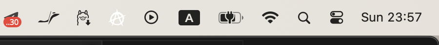
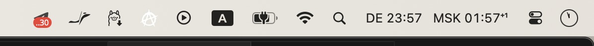

# MultiClock Free

Two time zones in the macOS menu bar, right next to the system clock. Free,
open source, no subscription, no Dock icon, no dependencies.

A free alternative to Dato ($7.99), World Clock Pro ($5.99) and similar paid
menu bar clocks, for the one thing most people need: *my time and their time*.

| Before | After |
|---|---|
|  |  |

The whole app was built in one evening by a coding agent from a voice message.
The prompt and the acceptance tests that make it reproducible are in this
repository: [PROMPT.md](PROMPT.md) (English) and [PROMPT.ru.md](PROMPT.ru.md)
(Russian). Paste either into Claude Code, Codex or any coding agent on a Mac and
you get the same app, built and tested on your machine.

## Features

- Two zones side by side: `DE 23:57   MSK 01:57⁺¹`. Default Berlin + Moscow.
- `⁺¹` / `⁻¹` when the other zone is already on the next (previous) day.
- Both zones change from the menu: 20 presets or any IANA identifier
  (`Europe/Lisbon`) with autocomplete and your own short label.
- 12/24-hour format follows the system locale. Monospaced digits, no jitter.
- Dropdown shows full date and time for both zones.
- Launch at login (a per-user LaunchAgent, toggled from the menu).
- Universal binary (Apple Silicon + Intel), macOS 10.15 Catalina and later.
- Settings live in `defaults read com.fedrbodr.multiclock`.

## Install

**Option A, download.** Grab `MultiClock-<version>.zip` from
[Releases](https://github.com/FedrBodrLain/multiclock-free/releases), unzip, move
`MultiClock.app` to `~/Applications` (or `/Applications`), then right-click it
and choose **Open** once. The app is signed ad hoc, not notarized, so Gatekeeper
asks the first time. If it refuses even then:

```sh
xattr -d com.apple.quarantine ~/Applications/MultiClock.app
```

**Option B, build.** Needs only Xcode Command Line Tools
(`xcode-select --install`), not Xcode itself.

```sh
git clone https://github.com/FedrBodrLain/multiclock-free.git
cd multiclock-free
swift run -c release multiclock-check   # 78 checks, must print 0 failed
./build.sh                               # installs ~/Applications/MultiClock.app and starts it
```

## Use

- Click the clock: change **First zone** / **Second zone**, toggle **Launch at
  login**, quit.
- Move it: hold **⌘** and drag the text along the menu bar. macOS keeps the
  system clock and Control Center at the far right, so the closest spot is just
  left of them.

## Hide the system clock (the "after" look)

macOS does not let you remove its own clock, but you can shrink it to a tiny
analog dial. System Settings → Control Center → Clock Options: style **Analog**,
show date **Never**, day of week **off**. Or from the terminal:

```sh
defaults write com.apple.menuextra.clock IsAnalog -bool true
defaults write com.apple.menuextra.clock ShowDate -int 2
defaults write com.apple.menuextra.clock ShowDayOfWeek -bool false
killall ControlCenter
```

Details and the way back: [docs/native-clock.md](docs/native-clock.md).

## Project layout

```
Sources/MultiClockCore/   pure logic: Zone, presets, ClockRenderer, LaunchAgent
Sources/MultiClock/       AppKit glue: status item, menu, dialogs
Sources/multiclock-check/ dependency-free test runner (XCTest is absent from CLT installs)
Resources/Info.plist      bundle metadata (LSUIElement = no Dock icon)
build.sh                  per-arch release builds + lipo + ad hoc codesign + install
PROMPT.md, PROMPT.ru.md   the prompt-plan that rebuilds all of this
```

## License

MIT. Made by [FedrBodr](https://github.com/FedrBodrLain).

---

## По-русски

Два часовых пояса в строке меню macOS рядом с системными часами. Бесплатно,
исходники открыты, без подписки, без иконки в Доке, без зависимостей.
Бесплатная альтернатива Dato (7,99 $), World Clock Pro (5,99 $) и прочим
платным часам для строки меню.

Приложение собрал агент за один вечер по голосовому сообщению. Промпт и
приёмочные тесты, по которым его можно повторить, лежат здесь:
[PROMPT.ru.md](PROMPT.ru.md). Вставьте его в Claude Code, Codex или любого
агента на Маке и получите то же приложение, собранное и проверенное у вас.

**Установка.** Скачать zip из [Releases](https://github.com/FedrBodrLain/multiclock-free/releases),
распаковать, перенести `MultiClock.app` в `~/Applications`, один раз открыть
через правый клик → «Открыть» (подпись ad hoc, без нотаризации). Или собрать:
`swift run -c release multiclock-check && ./build.sh` при установленных
Command Line Tools.

**Переместить.** Зажать ⌘ и перетащить текст по строке меню. Правее Пункта
управления и системных часов macOS не пускает.

**Спрятать системные часы.** Полностью нельзя, но можно сжать до маленького
аналогового кружка: Системные настройки → Пункт управления → Параметры часов:
Аналоговые, дата «Никогда», день недели выкл. Команды для терминала и откат:
[docs/native-clock.md](docs/native-clock.md).
